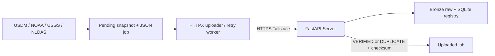

# Climate Collector ? Stage 1.5

**1 CLIENT ? 1 SERVER.** M?t physical Client ch?y b?n module USDM, NOAA, USGS, NLDAS,
d?ng persistent queue, HTTPX streaming v? worker g?i l?i khi Server ph?c h?i.
Collector th?t hi?n v?n l? skeleton; demo d?ng CSV mock nh?, kh?ng ph?i d? li?u khoa h?c.



## C?i ??t Windows

```powershell
git clone https://github.com/phamquocanh149/IT5425_DataLakeHouse_Client.git climate-collector
cd climate-collector
py -3.11 -m venv .venv
.\.venv\Scripts\python.exe -m pip install -r requirements.txt
if (!(Test-Path .env)) { Copy-Item .env.example .env }
```

D?ng Python 3.11/3.12. `.env`: `CLIENT_ID=collector01`, `CLIENT_ROLE=all`,
`SERVER_API_KEY` b?ng `COLLECTOR_API_KEY` Server c?p; kh?ng d?ng Admin key.
`CLIENT_ID` ch? d?ng c?c b?, Server l?y danh t?nh t? kh?a. URL loopback trong m?u ch?
cho demo c?ng m?y; hai m?y ph?i d?ng URL HTTPS Tailscale c?a Server.
Kh?ng commit `.env`, kh?ng sao ch?p `.venv` gi?a m?y; bi?n m?i tr??ng ?u ti?n h?n `.env`.
`SOURCE_<USDM|NOAA|USGS|NLDAS>_ENABLED=true/false` ?i?u khi?n t?ng ngu?n; tr?ng th?i t?ng job
c? source v? worker ghi th?ng k? ri?ng trong `data/source_status.json`.
C?c role c? v?n ??c ???c nh?ng kh?ng ph?i workflow m?c ??nh.

## G?i file

```powershell
.\.venv\Scripts\python.exe scripts/check_server.py
.\.venv\Scripts\python.exe scripts/generate_sample.py --source usdm
.\.venv\Scripts\python.exe scripts/send_file.py --file data/pending/sample_usdm.csv --source usdm --date 2021-06-22 --dataset-key usdm/demo
```

?? g?i NOAA c? th? d?ng c?ng mock file v?i `--source noaa --dataset-key noaa/demo`.
Gi?i h?n m?c ??nh 20 MiB; kh?ng ??c nguy?n file v?o RAM, timeout c?u h?nh ???c, lu?n
ki?m tra ch?ng ch? TLS. Kh?ng theo redirect mang key. Gi? nguy?n file ngu?n.

API gi? `/health`, `/upload`, `/uploads`, header X-API-Key v? multipart file/source/source_date.
Th?m `dataset_key` t?y ch?n: ??nh danh ?n ??nh s?n ph?m/tr?m/ch? s?; m?c ??nh filename g?c.
Server m?i tr? HTTP 200 VERIFIED/DUPLICATE v? metadata; Client ki?m tra source, ng?y,
dataset_key, checksum v? size tr??c khi x?c nh?n. Response Server c? thi?u dataset_key
ch? ???c ch?p nh?n khi key b?ng filename. Xem [API contract](docs/API_CONTRACT.md).

## Persistent queue v? worker

```powershell
.\.venv\Scripts\python.exe scripts/retry_pending.py --once
.\.venv\Scripts\python.exe scripts/retry_pending.py --watch --interval 10
```

`send_file.py` t?o `data/pending/<job_id>/payload` v? metadata.json, fsync payload tr??c
khi ghi metadata nguy?n t?. Retry worker d?ng l?i job_id, filename, source, ng?y,
dataset_key v? payload; **kh?ng t?o snapshot ho?c job m?i**. C? uploader l?n worker d?ng
OS file lock trong `data/locks`; kernel gi?i ph?ng lock khi process ch?t, kh?ng ph?i x?a
lock file th? c?ng. Backoff v? attempts ???c ghi tr??c request ?? restart kh?ng reset budget.

Client state: `PENDING ? UPLOADING ? UPLOADED`; l?i t?m ? `RETRY_PENDING`; l?i c?n s?a
? `NEEDS_ATTENTION`. `server_status` ri?ng l? VERIFIED ho?c DUPLICATE. VERIFIED ch? c?
ngh?a Bronze v? metadata ?? ???c x?c nh?n, ch?a ph?i Silver/Gold.

- M?i l?n upload tr?c ti?p retry t?i ?a `UPLOAD_RETRY_COUNT` (m?c ??nh 3 l?n sau l?n ??u).
- T?ng request t? ??ng cho m?t job b? ch?n b?i `WORKER_MAX_ATTEMPTS` (m?c ??nh 12),
  k? c? qua restart. Worker m?i v?ng ch? g?i m?t l?n/job ??n h?n, ki?m tra health tr??c.
- Retry network/timeout v? 408/429/500/502/503/504. Backoff trong l?n g?i 1,2,4? t?i ?a
  30s; gi?a v?ng worker 2^attempts t?i ?a 1024s. Kh?ng g?i l?i s?m h?n deadline ?? l?u.
- 400/401/403/404/409/413/422 ho?c checksum/identity sai: NEEDS_ATTENTION; kh?ng t? retry.
- Ctrl+C d?ng watch sau request hi?n t?i, t?i ?a ch? timeout; kh?ng t? c?i Service/Task.
- `failed/<job_id>.json` l? b?o c?o, payload v?n ? pending. Ch? chuy?n nguy?n th? m?c
  sang uploaded sau x?c nh?n. N?u crash sau l?u acknowledgement nh?ng tr??c rename,
  worker ho?n t?t move m? kh?ng upload l?i. L?i record/incomplete snapshot ???c b?o,
  kh?ng t? x?a file. Snapshot ch?a ho?n t?t kh?ng ???c g?i.
- Pending Phase 1 c? metadata c? ???c n?ng c?p khi ??c; CSV r?i ch?a c? job metadata
  kh?ng t? g?i. D?ng send_file l?n ??u cho c?c file n?y.

Khi NEEDS_ATTENTION: s?a URL/key/quy?n/payload r?i x? l? c? ch? ??ch. Kh?ng t? reset
budget. C? th? g?i l?i file ngu?n th?nh job m?i b?ng send_file sau khi x?c ??nh l?i ??
kh?c ph?c; record l?i c? gi? l?m audit. Kh?ng t? s?a raw ho?c ??i ng?y/source ?? n? l?i.

## Server v? metadata

Server ch?ng tr?ng theo `(source, source_date, dataset_key, sha256)`; c?ng bytes kh?c ng?y
v?n l? observation m?i. ??i bytes t?o revision, kh?ng ghi ??; retry revision c? tr? b?n
c?, kh?ng thay current. Physical blob c? th? d?ng chung gi?a observation.
SQLite n?m tr?n Server (`metadata/ingestion.sqlite3`), kh?ng truy c?p tr?c ti?p qua m?ng.
Collector ch? xem metadata c?a m?nh v? source ???c c?p quy?n; Admin xem t?t c?.
Server c? migration JSON v? reconciliation; xem README repo Server.

## Ki?m th?

```powershell
.\.venv\Scripts\python.exe -m pytest -q
```

HTTP integration th?t n?m trong repo Server, ch?y c? hai codebase:

```powershell
cd ..\climate-platform
$env:CLIENT_REPO_PATH=(Resolve-Path ..\climate-collector).Path
.\.venv\Scripts\python.exe -m pytest tests/integration -q
```

Test d?ng temporary keys/storage, g?m offline/restart v? hai process g?i ??ng th?i.
Xem [demo 5?7 ph?t](docs/STAGE_1_5_DEMO.md), [validation](VALIDATION.md).

## HTTPS Tailscale tr?n hai m?y

C? hai m?y v?o c?ng tailnet, ???c c?p quy?n. Server gi? Uvicorn t?i 127.0.0.1:8000;
ng??i v?n h?nh b?t HTTPS certificates v? d?ng `tailscale serve --bg 8000` tr?n Server.
?i?n URL HTTPS tr? v? v?o SERVER_BASE_URL Client. Kh?ng d?ng localhost khi Server ?
m?y kh?c, kh?ng t?t TLS. Ch? cung c?p h??ng d?n; ch?a ch?y smoke test hai m?y th?c t?.
[T?i li?u Tailscale Serve](https://tailscale.com/docs/reference/tailscale-cli/serve).

## Ph?m vi hi?n t?i

Worker tu?n t?, tr?ng th?i local filesystem, ch?a c? daemon/Task Scheduler t? c?i.
C?c downloader v? Historical Replay thu?c Stage 2; Silver/Gold thu?c Stage 3,
ch?a tri?n khai. Khi m? r?ng, gi? dataset_key ?n ??nh v? m?i ngu?n c? checkpoint ri?ng,
??a raw v?o enqueue_file r?i ?? worker ph? tr?ch truy?n.
